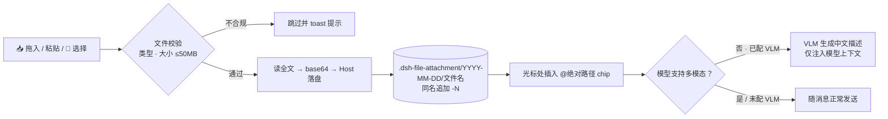
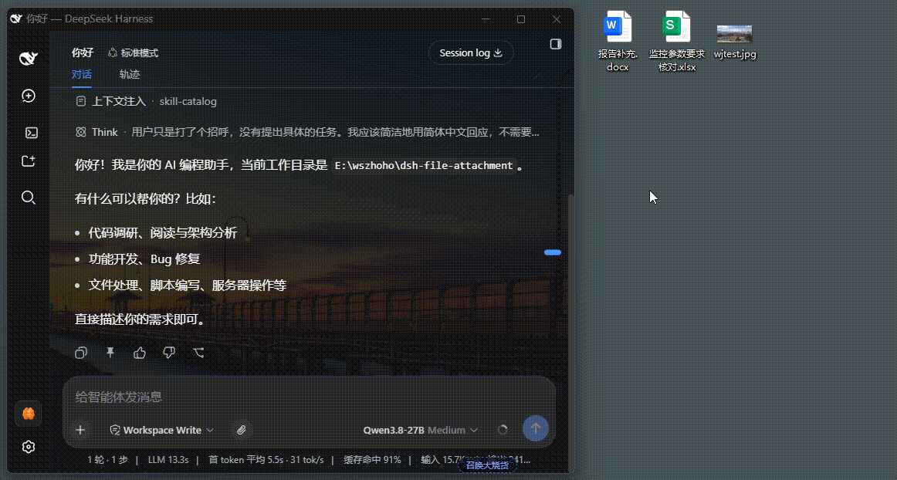
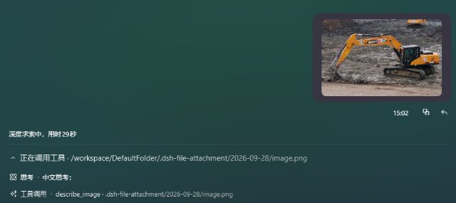
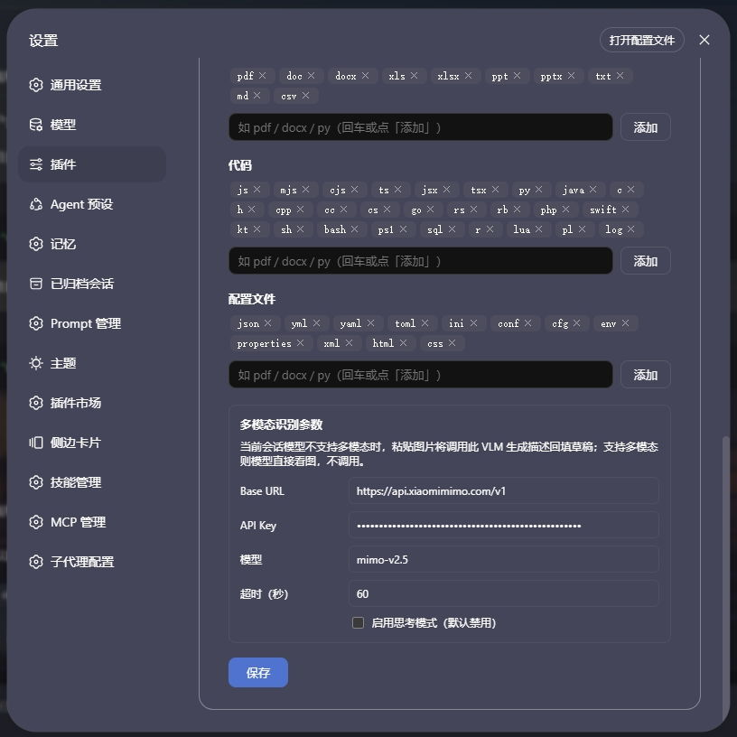
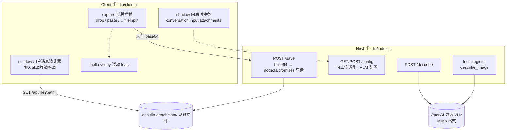

# dsh-file-attachment

<p align="right"><a href="#english">English</a> | 中文</p>

<div align="center">

[](https://www.npmjs.com/package/@wszhoho/dsh-file-attachment)
[](https://www.npmjs.com/package/@wszhoho/dsh-file-attachment)
[](https://nodejs.org)
[](./LICENSE)

**文件附件插件 for [DeepSeek Harness (DSH)](https://www.npmjs.com/package/@deepseek-ai/dsh) Web GUI**

拖拽 / `Ctrl+V` 粘贴 / 📎 按钮上传 · 内联缩略图 · `@绝对路径` 引用 · VLM 图片识别

</div>

> **File attachment plugin for DSH web GUI:** drag, paste, or upload files and images from the composer; inline thumbnails, clickable previews, `@absolute-path` references, and optional VLM-generated image descriptions.

## 目录

- [快速开始](#快速开始)
- [核心能力](#核心能力)
- [处理流程](#处理流程)
- [界面](#界面)
- [行为一览](#行为一览)
- [存储细节](#存储细节)
- [安装](#安装)
- [架构](#架构)
- [开发说明](#开发说明)
- [English](#english)

## 快速开始

```powershell
dsh plugin --profile web add @wszhoho/dsh-file-attachment
```

安装后重启 web GUI 即生效。

## 核心能力

| 能力 | 说明 |
| :--- | :--- |
| 📥 **三种入口** | 拖入、`Ctrl+V` 粘贴、接管 dsh 原生 📎 附件按钮（加号右侧、modes 左侧，可多选）；PC 与移动端浏览器均适用 |
| 🗂️ **统一落盘管线** | 图片与文档同走一条链路，保存到 `<会话工作区>/.dsh-file-attachment/<日期>/<文件名>`；同名冲突追加 `-N` 绝不覆盖；单文件上限 50MB |
| 🔗 **`@绝对路径` 引用** | 落盘后在光标处插入 chip，文本模型也能「看懂」附件 |
| 🖼️ **双区预览** | 输入框内联附件条（图片缩略图 / 文档类型图标 + 文件名，可移除并同步清除引用）；聊天区图片渲染为可点击放大的缩略图（Lightbox） |
| 🤖 **VLM 识别** | 非多模态模型下自动调用 OpenAI 兼容接口生成中文图片描述回填草稿（仅注入模型上下文）；agent 可主动调用 `describe_image` 工具 |

## 处理流程



## 界面

**演示**：拖入/粘贴 → 落盘并插入 `@` 引用 → 输入框内联附件条待发送状态。





**设置页**（「设置 → 文件附件」）：

| 设置组 | 内容 |
| :--- | :--- |
| **可上传类型** | 按文档 / 代码 / 配置文件三类增删扩展名（小写不带点，图片恒可发送） |
| **VLM 参数** | Base URL / API Key / 模型 / 思考模式开关（默认禁用）/ 超时时间（默认 60 秒）；未填 API Key 时静默跳过 |



## 行为一览

| 操作 | 行为 |
| --- | --- |
| 📎 按钮多选 / 拖入 / 粘贴文档、代码、配置文件 | 读全文 → base64 → 落盘 → 光标一次性插入全部 `@` 引用；成功不提示，失败简短 toast |
| 一次多个文件 | 批量处理，一次性插入全部引用；部分失败仅提示「N 个已跳过」 |
| 拖入 / 粘贴图片 | 同一管线落盘 + 插引用；附件条缩略图预览，聊天区可点击放大 |
| 当前模型不支持多模态 | 自动调 VLM 生成中文描述回填草稿；agent 可用 `describe_image` 工具 |
| 拖入目录 | 拒绝，toast 提示「不支持拖入目录」 |
| 粘贴纯文本 | 不改写，完全原生行为 |
| 重复拖入同名文件（同一天内） | 追加 `-1`、`-2` 序号，绝不覆盖 |
| 点附件条 `×` 移除 | 移除条目并清除该文件路径的全部 `@` 引用 chip，其他文件不受影响 |
| 单文件 > 50MB | 跳过并提示 |

## 存储细节

- **命名**：`.dsh-file-attachment/YYYY-MM-DD/<清洗后文件名>`（如 `.dsh-file-attachment/2026-02-11/说明.docx`），同日同名在扩展名前追加 `-N`。
- **根目录** = 当前会话工作区（回退顺序：`session.header.cwd` → `sandboxPolicy.workspaceRoot` → `process.cwd()`），每个项目各自维护自己的 `.dsh-file-attachment/`。
- **跨平台**：保存路径用 `path.join` 自适应分隔符；文件名清洗对 Windows / POSIX 均安全；Host 半经 `node:fs/promises` 直接写字节，无 shell 依赖。

## 安装

本仓库是标准 dsh 插件包（声明了 `dsh.bundle.patch`），已发布 npm 包 `@wszhoho/dsh-file-attachment`。`dsh plugin add` 的参数会转发给 profile 目录的 pnpm 执行，三种来源任选其一：

```powershell
# 从 npm 安装（普通用户推荐）
dsh plugin --profile web add @wszhoho/dsh-file-attachment

# 本地源码安装（开发用，边改边验；相对路径等价 pnpm link，改完 lib/*.js 后重启 GUI 即生效）
cd <parent>
dsh plugin --profile web add ./dsh-file-attachment

# 从 GitHub 安装
dsh plugin --profile web add github:wszhoho/dsh-file-attachment
```

无论哪种来源，安装后都自动进入 profile 的 `dsh.profile.bundles`，无需手改 profile `package.json`；升级：`dsh plugin --profile web update dsh-file-attachment`。

## 架构

```
├── package.json          # dsh.client 声明 + bundle patch 指向
├── cordis.patch.yml      # bundle 补丁：插入本插件行
└── lib/
    ├── index.js          # Host 半：webServer 路由（/save /config /describe）+ describe_image 工具
    └── client.js         # Client 半：document 级 capture drop/paste 监听 + 📎 按钮接管 + 槽组件
```



- **Host 半**：前缀路由 `/dsh-file-attachment`——POST `/save`（base64 解码后用 `node:fs/promises` 写盘）、GET/POST `/config`（读写可上传类型与 VLM 配置）、POST `/describe`（调 VLM 返回中文描述与思考模式配置）；另经 `tools.register` 注册 `describe_image` 工具。响应信封 `{ ok, value | error }`。
- **Client 半**：shadow 原生附件条（`conversation.input.attachments`）实现内联附件条；shadow 用户消息渲染器（`conversation.chat.node` keyed `user`）把聊天区 `@图片路径` 渲染为缩略图（经宿主 `/api/file?path=` 读取落盘图片）；capture 阶段拦截原生 `fileInput` change 事件接管 📎 按钮，文件进入插件统一管线；纯文本粘贴完全原生不改写。
- **通知与浮层**：`shell.overlay` frame-wide 浮动 toast（不参与文档流，4 秒自动消失）；拖入任何文件时 capture 阶段拦截应用自带的图片 DropOverlay（其文案对文档是误导）。

## 开发说明

- `lib/*.js`、`package.json`、`cordis.patch.yml`、`README.md` 均为 UTF-8 无 BOM，编辑时保持原编码。
- 纯 ESM 无构建，不依赖装饰器 / 远程反射。
- VLM 请求按 MiMo 官方格式发送 `thinking: { type: "enabled"|"disabled" }`（扁平 `thinkingType` 会被 API 忽略；mimo-v2.5 默认开启深度思考导致识别极慢——实测 206 秒 vs 关闭后 22~73 秒）；超时后明确报错中止而非挂死会话；未填 API Key 时识别静默跳过，不影响落盘。
- 50MB 上限两侧一致（client 跳过 + host 校验）。

## Star

如果这个插件帮到了你，欢迎到 [GitHub 仓库](https://github.com/wszhoho/dsh-file-attachment) 点个 ⭐ Star，感谢支持！

## English

**dsh-file-attachment** is a [DeepSeek Harness (DSH)](https://www.npmjs.com/package/@deepseek-ai/dsh) web GUI plugin for attaching files and images to the chat composer via drag-and-drop, paste, or the native DSH paperclip button.

Key capabilities: unified storage pipeline under `.dsh-file-attachment/`; `@absolute-path` references so text-only models can use attachments; inline attachment previews plus clickable chat thumbnails with a lightbox; multi-file upload with same-name conflict handling and a 50MB guard; optional OpenAI-compatible VLM descriptions for non-multimodal models; works on desktop and mobile browsers.

Install:

```powershell
dsh plugin --profile web add @wszhoho/dsh-file-attachment
```

For detailed behavior, settings, architecture, and development notes, see the Chinese documentation above.

## License

MIT
